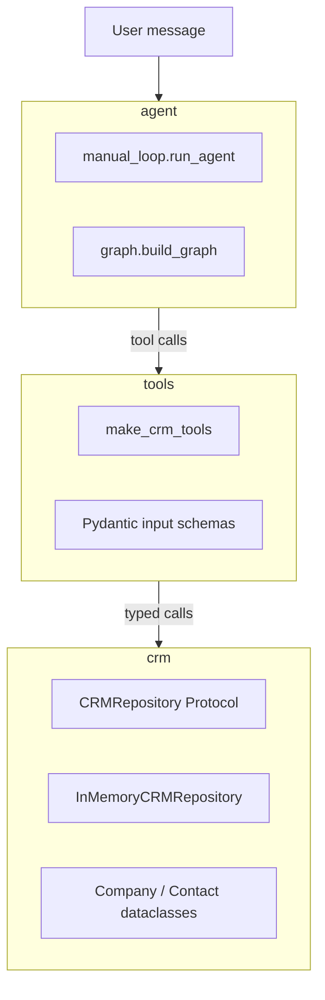
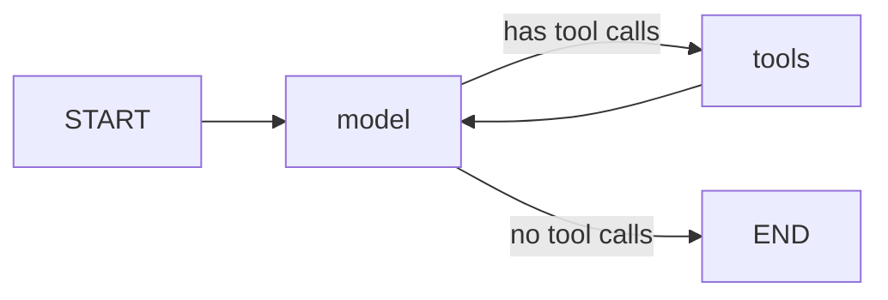
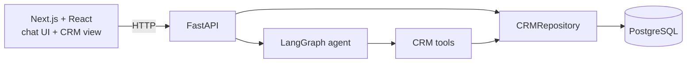

# CRM Agent Prototype

A small, fully typed Python project that lets an LLM agent create and look up records in a CRM using natural language.

> "Add Maria from Acme" → the agent searches for the company "Acme", gets its ID, and creates the contact "Maria" linked to it.

The goal of this repository is to be a **readable, end-to-end example** of how tool-calling agents work with [LangChain](https://python.langchain.com/) and [LangGraph](https://langchain-ai.github.io/langgraph/), without hiding the mechanics behind high-level abstractions. Every line was written by hand; AI was used only as a code reviewer.

## Status

Work in progress. What exists today:

- ✅ CRM domain (companies and contacts) with an in-memory repository
- ✅ Three LangChain tools with Pydantic input schemas and input normalization
- ✅ A hand-written agent loop (`manual_loop.py`), tested with a fake chat model
- ✅ The same agent expressed as a LangGraph `StateGraph` (`graph.py`)

Planned next (see [Roadmap](#roadmap)):

- ⏳ Connect a real LLM provider
- ⏳ FastAPI backend serving the agent and the CRM data
- ⏳ PostgreSQL repository replacing the in-memory one
- ⏳ Next.js + React chat frontend that shows records being created and updated live

## How it works

The project is split into three layers. Each layer only knows about the one below it.



| Layer | Responsibility | Knows about LLMs? |
|-------|----------------|-------------------|
| `crm` | Domain models, business rules (e.g. unique CNPJ, contact must reference an existing company) and storage | No |
| `tools` | Translates between the LLM world (JSON args, string results) and the domain | Partially: tool descriptions and schemas are written for the model |
| `agent` | Runs the model ↔ tools loop until the model gives a final answer | Yes |

### The agent loop

Both agent implementations do the same thing:

1. Send the message history to the model.
2. If the model answers with `tool_calls`, execute each tool and append a `ToolMessage` with the result.
3. Repeat until the model answers without tool calls (the final answer).

Example run for "Add Maria from Acme":

| # | Message | Content |
|---|---------|---------|
| 0 | `HumanMessage` | "Add Maria from Acme" |
| 1 | `AIMessage` | tool call → `find_companies(query="Acme")` |
| 2 | `ToolMessage` | `{"companies": [{"company_id": "...", "name": "Acme LTDA", ...}]}` |
| 3 | `AIMessage` | tool call → `create_contact(name="Maria", company_id="...")` |
| 4 | `ToolMessage` | `{"contact_id": "...", "name": "Maria", "company_id": "...", ...}` |
| 5 | `AIMessage` | "Maria added!" |

This message sequence is asserted in [tests/test_manual_loop.py](tests/test_manual_loop.py) (the test uses the same prompt in Portuguese).

The LangGraph version models the same loop as a graph:



### Available tools

| Tool | Arguments | Notes |
|------|-----------|-------|
| `create_company` | `name`, `cnpj?` | CNPJ is normalized to digits only and must have 14 digits; duplicates are rejected |
| `create_contact` | `name`, `phone?`, `email?`, `company_id?` | Phone is normalized to digits only (10–13 digits); email is validated; `company_id` must exist |
| `find_companies` | `query` | Substring match on name (case-insensitive) or on CNPJ |

## Design decisions

These are the choices I would highlight when walking through the code.

**Repository as a `Protocol`.** `CRMRepository` is a `typing.Protocol`, so the tools depend on an interface instead of a concrete storage. `InMemoryCRMRepository` satisfies it structurally (no inheritance), which keeps tests fast and makes it possible to swap in a real database later without touching the tools.

**Immutable domain models.** `Company` and `Contact` are `frozen=True, kw_only=True` dataclasses. IDs and `created_at` are generated by default factories, and timestamps are timezone-aware (UTC).

**Tools built by a factory (dependency injection).** `make_crm_tools(repo)` defines the tools as closures over the repository passed in. There is no global state, and each test gets its own isolated repository through a pytest fixture.

**Pydantic schemas as the contract with the model.** Each tool has an explicit `args_schema`. The field `description`s are what the LLM reads, so they double as prompt engineering. Validators also clean up what models (and users) typically send, e.g. `"12.345.678/0001-95"` becomes `"12345678000195"`.

**Two kinds of errors, handled differently.**
- *Business errors* (`CRMError`, e.g. duplicate CNPJ, unknown company) are caught inside the tool and returned to the model as `{"error": "..."}`, so the model can explain the problem or try something else.
- *Invalid arguments* (`ValidationError`) and *unknown tool names* are caught by the agent loop and turned into a `ToolMessage` with `status="error"`, so a bad tool call does not crash the conversation.

**A manual loop before LangGraph.** `manual_loop.py` implements the agent loop by hand, including a `max_iterations` guard that raises `MaxIterationsReachedError`. It exists to make the mechanics explicit (tool call IDs, message ordering, error messages). `graph.py` then expresses the same loop with LangGraph's `StateGraph`, `ToolNode` and `tools_condition`.

**Deterministic tests without an API key.** The agent loop is tested with LangChain's `FakeMessagesListChatModel`, which replays a scripted list of `AIMessage`s. This tests the loop logic, not the model's reasoning.

## Project structure

```
src/crm_agent/
├── crm/
│   ├── models.py        # Company and Contact dataclasses
│   ├── errors.py        # CRMError hierarchy
│   └── repository.py    # CRMRepository Protocol + in-memory implementation
├── tools/
│   ├── schemas.py       # Pydantic input schemas and normalizers
│   └── crm_tools.py     # make_crm_tools(repo) -> list[BaseTool]
└── agent/
    ├── manual_loop.py   # hand-written model <-> tools loop
    └── graph.py         # same loop as a LangGraph StateGraph
tests/
├── conftest.py          # repo and tools fixtures
├── test_repository.py
├── test_schemas.py
├── test_crm_tools.py
└── test_manual_loop.py
```

## Getting started

Requirements: Python 3.13+ and [uv](https://docs.astral.sh/uv/).

```bash
git clone <this-repo-url>
cd crm-agent-prototype
uv sync
```

Run the checks:

```bash
uv run pytest
uv run ruff check .
uv run mypy src tests
```

## Tech stack

- **Python 3.13**, managed with **uv**
- **langchain-core**: messages, `BaseChatModel`, `@tool`
- **langgraph**: `StateGraph`, `MessagesState`, `ToolNode`
- **pydantic v2**: tool input schemas and validation
- **pytest**, **ruff**, **mypy** (`strict = true`)

## Roadmap

The end goal is a small full-stack app: chat with the agent in the browser and watch the CRM records change next to the conversation.



**1. Agent core** (current)
- [x] Domain, repository Protocol and in-memory implementation
- [x] Tools with Pydantic schemas
- [x] Manual agent loop + LangGraph version
- [ ] Update tools (e.g. change a contact's email or company)
- [ ] Connect a real chat model with tool-calling support
- [ ] Tests for the LangGraph version

**2. Backend**
- [ ] FastAPI app exposing a chat endpoint for the agent
- [ ] Endpoints to read companies and contacts
- [ ] PostgreSQL implementation of `CRMRepository`

**3. Frontend**
- [ ] Next.js + React chat interface to talk to the agent
- [ ] Side panel listing companies and contacts, updated as the agent creates or changes them
