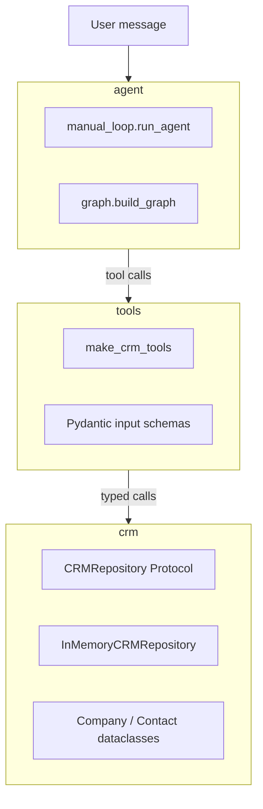
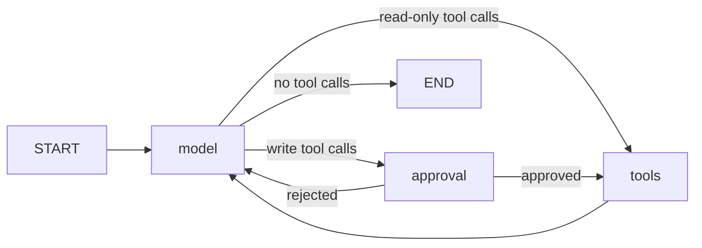
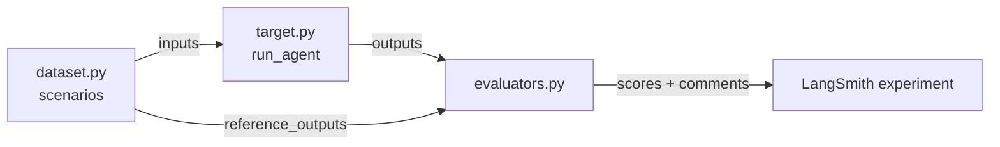
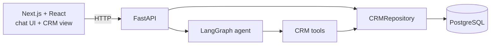

# CRM Agent Prototype

A small, fully typed Python project that lets an LLM agent create and look up records in a CRM using natural language.

> "Add Maria from Acme" → the agent searches for the company "Acme", gets its ID, and creates the contact "Maria" linked to it.

The goal of this repository is to be a **readable, end-to-end example** of how tool-calling agents work with [LangChain](https://python.langchain.com/) and [LangGraph](https://langchain-ai.github.io/langgraph/), without hiding the mechanics behind high-level abstractions. Every line was written by hand; AI was used only as a code reviewer.

## Status

Work in progress. What exists today:

- ✅ CRM domain (companies and contacts) with an in-memory repository
- ✅ Three LangChain tools with Pydantic input schemas and input normalization
- ✅ A hand-written agent loop (`manual_loop.py`), tested with a fake chat model
- ✅ The agent rebuilt as a LangGraph `StateGraph` (`graph.py`), which adds a system prompt, a checkpointer and human approval before writing to the CRM
- ✅ A terminal chat (`cli.py`) running the graph against a real Claude model, traced with LangSmith
- ✅ Offline evaluations in LangSmith: a scenario dataset, a target that runs the real agent, and unit-tested evaluators (`evals/`)
- ✅ A FastAPI endpoint to chat with the agent per thread (`api.py`), which reports pending approvals

Planned next (see [Roadmap](#roadmap)):

- ⏳ Approve or reject pending writes through the API, and endpoints to read the CRM data
- ⏳ PostgreSQL repository replacing the in-memory one
- ⏳ Next.js + React chat frontend that shows records being created and updated live

## How it works

The project is split into three layers. Each layer only knows about the one below it.



| Layer | Responsibility | Knows about LLMs? |
|-------|----------------|-------------------|
| `crm` | Domain models, business rules (e.g. unique CNPJ, contact must reference an existing company) and storage | No |
| `tools` | Translates between the LLM world (JSON args, string results) and the domain | Partially: tool descriptions and schemas are written for the model |
| `agent` | Runs the model ↔ tools loop until the model gives a final answer | Yes |

### The agent loop

Both agent implementations share the same core loop:

1. Send the message history to the model.
2. If the model answers with `tool_calls`, execute each tool and append a `ToolMessage` with the result.
3. Repeat until the model answers without tool calls (the final answer).

Example run for "Add Maria from Acme":

| # | Message | Content |
|---|---------|---------|
| 0 | `HumanMessage` | "Add Maria from Acme" |
| 1 | `AIMessage` | tool call → `find_companies(query="Acme")` |
| 2 | `ToolMessage` | `{"companies": [{"company_id": "...", "name": "Acme LTDA", ...}]}` |
| 3 | `AIMessage` | tool call → `create_contact(name="Maria", company_id="...")` |
| 4 | `ToolMessage` | `{"contact_id": "...", "name": "Maria", "company_id": "...", ...}` |
| 5 | `AIMessage` | "Maria added!" |

This message sequence is asserted in [tests/test_manual_loop.py](tests/test_manual_loop.py) (the test uses the same prompt in Portuguese).

The LangGraph version models that loop as a graph and goes further: a write tool call passes through an `approval` node first.



The `approval` node only exists when `build_graph` receives `approval_required_tools`. It pauses the graph with LangGraph's `interrupt()`, which requires a checkpointer. If the user rejects, each pending tool call gets a `ToolMessage` with `status="error"` and the model decides what to do next.

### Available tools

| Tool | Arguments | Notes |
|------|-----------|-------|
| `create_company` | `name`, `cnpj?` | CNPJ is normalized to digits only and must have 14 digits; duplicates are rejected |
| `create_contact` | `name`, `phone?`, `email?`, `company_id?` | Phone is normalized to digits only (10–13 digits); email is validated; `company_id` must exist |
| `find_companies` | `query` | Substring match on name (case-insensitive) or on CNPJ |

## Design decisions

These are the choices I would highlight when walking through the code.

**Repository as a `Protocol`.** `CRMRepository` is a `typing.Protocol`, so the tools depend on an interface instead of a concrete storage. `InMemoryCRMRepository` satisfies it structurally (no inheritance), which keeps tests fast and makes it possible to swap in a real database later without touching the tools.

**Immutable domain models.** `Company` and `Contact` are `frozen=True, kw_only=True` dataclasses. IDs and `created_at` are generated by default factories, and timestamps are timezone-aware (UTC).

**Tools built by a factory (dependency injection).** `make_crm_tools(repo)` defines the tools as closures over the repository passed in. There is no global state, and each test gets its own isolated repository through a pytest fixture.

**Pydantic schemas as the contract with the model.** Each tool has an explicit `args_schema`. The field `description`s are what the LLM reads, so they double as prompt engineering. Validators also clean up what models (and users) typically send, e.g. `"12.345.678/0001-95"` becomes `"12345678000195"`.

**Two kinds of errors, handled differently.**
- *Business errors* (`CRMError`, e.g. duplicate CNPJ, unknown company) are caught inside the tool and returned to the model as `{"error": "..."}`, so the model can explain the problem or try something else.
- *Invalid arguments* (`ValidationError`) and *unknown tool names* are caught by the agent loop and turned into a `ToolMessage` with `status="error"`, so a bad tool call does not crash the conversation.

**A manual loop before LangGraph.** `manual_loop.py` implements the agent loop by hand, including a `max_iterations` guard that raises `MaxIterationsReachedError`. It exists to make the mechanics explicit (tool call IDs, message ordering, error messages). `graph.py` then rebuilds the loop with LangGraph's `StateGraph` and `ToolNode`, plus what the manual loop doesn't have: a system prompt, a checkpointer for conversation memory, and a custom router that sends write tool calls to the `approval` node. The manual loop stays as it was, as a reference for the basic mechanics; the CLI and the evals use the graph.

**Deterministic tests without an API key.** The agent loop is tested with LangChain's `FakeMessagesListChatModel`, which replays a scripted list of `AIMessage`s. This tests the loop logic, not the model's reasoning. The model's reasoning is measured separately, with [evaluations](#evaluations).

## Evaluations

Unit tests prove the loop works; they can't tell whether the real model makes good decisions (search before creating, don't guess IDs, don't create a company nobody asked for). That is what `evals/` measures, using a LangSmith experiment.



**Dataset** (`dataset.py`). Each scenario has a user message, an optional `seed` (companies that already exist in the CRM) and the expected result:

| # | Scenario | Expected behavior |
|---|----------|-------------------|
| 1 | `formatted_cnpj` | Searches, then creates the company with the CNPJ normalized to digits |
| 2 | `link_to_existent_company` | Finds the seeded company and links the new contact to it |
| 3 | `link_to_nonexistent_company` | Searches, finds nothing and creates neither the contact nor the company |
| 4 | `ambiguous_company_link` | Two companies match "Acme": searches and asks instead of picking one |
| 5 | `duplicated_cnpj` | The CNPJ already exists: does not create the company again |
| 6 | `readonly_query` | Only searches; nothing is written |

Every scenario declares all four expected keys (`companies_created`, `contacts_created`, `tools_called`, `must_not_call`), with an explicit `[]` when nothing should happen. A missing key would force the evaluator to guess, and scoring "nothing to check" as a pass inflates the average.

**Target** (`target.py`). `run_agent(inputs)` builds everything from scratch for each run: a fresh in-memory CRM with the seed applied, the real Claude model, and the same graph as the CLI. It uses a new `thread_id` on every call (LangSmith runs scenarios in parallel and repeats them), approves every interrupt automatically, and returns a JSON-serializable dict:

| Key | Content |
|-----|---------|
| `answer` | The model's final text |
| `tools_called` | Tool names in call order, read from the `AIMessage.tool_calls` |
| `interrupts` | How many approvals were requested |
| `companies_created`, `contacts_created` | Only what the agent created (a snapshot taken before `invoke` excludes the seed) |

The dataset refers to seeded companies by aliases like `"c-1"`, while the repository generates UUIDs, so the target translates the `company_id` of created contacts back to the alias.

**Evaluators** (`evaluators.py`). Plain functions with no LLM calls, so they're tested with pytest in [tests/test_evaluators.py](tests/test_evaluators.py). LangSmith injects `outputs` and `reference_outputs` by parameter name. Each one returns a score and a comment, which appears next to the score in the LangSmith UI; the pass/fail ones show what came out versus what was expected.

| Evaluator | Score |
|-----------|-------|
| `companies_match` | Pass when `companies_created` equals the expected list |
| `contacts_match` | Pass when `contacts_created` equals the expected list |
| `tools_match` | Pass when the expected tools appear in `tools_called` in the same order; repeats and other tools in between are allowed (ordered subsequence) |
| `no_forbidden_tools` | Pass when no tool from `must_not_call` was called |
| `tool_call_count` | Not pass/fail: the number of tool calls, to compare how efficient the agent is between experiments |

**Running an experiment** (`run.py`). It uploads the dataset to LangSmith the first time (it is skipped if a dataset named `crm-agent` already exists), then calls `client.evaluate` with the target, the evaluators above and metadata identifying the model and the prompt version, so experiments can be compared later.

## Project structure

```
src/crm_agent/
├── crm/
│   ├── models.py        # Company and Contact dataclasses
│   ├── errors.py        # CRMError hierarchy
│   └── repository.py    # CRMRepository Protocol + in-memory implementation
├── tools/
│   ├── schemas.py       # Pydantic input schemas and normalizers
│   └── crm_tools.py     # make_crm_tools(repo) -> list[BaseTool]
├── agent/
│   ├── chat_models.py   # build_chat_anthropic_model()
│   ├── manual_loop.py   # hand-written model <-> tools loop
│   └── graph.py         # LangGraph StateGraph with system prompt and approval node
├── api.py               # FastAPI app: POST /threads/{thread_id}/messages
└── cli.py               # terminal chat with a real Claude model
evals/
├── dataset.py           # evaluation scenarios
├── target.py            # run_agent(inputs): runs the real agent for one scenario
├── evaluators.py        # scoring functions
└── run.py               # uploads the dataset and runs a LangSmith experiment
tests/
├── conftest.py          # repo and tools fixtures
├── test_repository.py
├── test_schemas.py
├── test_crm_tools.py
├── test_manual_loop.py
├── test_graph.py
├── test_evaluators.py
└── test_api.py          # TestClient with the graph dependency overridden by a fake model
```

## Getting started

Requirements: Python 3.13+ and [uv](https://docs.astral.sh/uv/).

```bash
git clone <this-repo-url>
cd crm-agent-prototype
uv sync
```

Run the checks:

```bash
uv run pytest
uv run ruff check .
uv run mypy src tests evals
```

### Chat with the agent in the terminal

The tests use a fake model. To talk to the agent with a real model, use the CLI. It runs the LangGraph version with Claude (`claude-haiku-5-5` through `ChatAnthropic`), an in-memory CRM and an in-memory checkpointer.

1. Copy `.env.example` to `.env` and fill in your keys:

   ```bash
   cp .env.example .env
   ```

   | Variable | Required | Purpose |
   |----------|----------|---------|
   | `ANTHROPIC_API_KEY` | Yes | Calls the Claude model |
   | `LANGSMITH_TRACING` | No | Set to `true` to send traces to LangSmith |
   | `LANGSMITH_API_KEY` | For tracing and evals | LangSmith key |
   | `LANGSMITH_PROJECT` | No | LangSmith project the traces go to |

2. Start the chat. The project doesn't load `.env` by itself, so pass it to `uv`:

   ```bash
   uv run --env-file .env crm-agent
   ```

The CLI talks in Portuguese. Type your requests at the `Você:` prompt and `sair` (or `exit` / `quit`) to leave. Before running `create_company` or `create_contact`, the agent pauses and asks for approval; answer `s`/`sim` to approve, anything else rejects the write:

```text
Você: Cadastre a empresa Acme com CNPJ 12.345.678/0001-95
Você aprova essa escrita no CRM? create_company: {'name': 'Acme', 'cnpj': '12.345.678/0001-95'}
s/n?
Você: s
Empresa Acme cadastrada!
```

The model's replies vary between runs. All data lives in memory, so the CRM starts empty every time the CLI starts.

### Run the API

Uses the same `.env` as the CLI:

```bash
uv run --env-file .env fastapi dev src/crm_agent/api.py
```

The interactive docs (Swagger) are at `http://127.0.0.1:8000/docs`. There is a single endpoint, `POST /threads/{thread_id}/messages`:

```jsonc
// Request body
{"message": "Crie a empresa Acme"}

// Response
{"answer": "...", "pending_approval": "Você aprova essa escrita no CRM? create_company: {'name': 'Acme'}"}
```

`pending_approval` is the interrupt's question when the agent wants to write to the CRM, or `null` otherwise. Approving or rejecting through the API is not implemented yet, so a write stays pending.

The graph, the repository and the checkpointer are built once (`get_graph` is wrapped in `@cache`) and shared by every request. Building them per request would lose the conversation and the CRM data between messages. Requests with a body missing `message` get a `422` from FastAPI's validation.

### Run the evaluations

These commands call the real model and need `ANTHROPIC_API_KEY` and `LANGSMITH_API_KEY` in `.env`.

Run a single scenario locally and print the target's output (the number is the scenario's position in the dataset, 1 to 6):

```bash
uv run --env-file .env python -m evals.target 2
```

Run the full experiment in LangSmith:

```bash
uv run --env-file .env python -m evals.run
```

Each scenario takes about three model calls, and `run.py` repeats every scenario `num_repetitions` times, so keep an eye on the cost. The dataset is only uploaded when it doesn't exist yet: after editing `dataset.py`, delete the `crm-agent` dataset in LangSmith (or rename `DATASET_NAME`) so the changes are uploaded. When you change the model or the prompt, update the `metadata` in `run.py` too.

## Tech stack

- **Python 3.13**, managed with **uv**
- **langchain-core**: messages, `BaseChatModel`, `@tool`
- **langgraph**: `StateGraph`, `MessagesState`, `ToolNode`, `interrupt`, `InMemorySaver`
- **langchain-anthropic**: `ChatAnthropic` for the CLI, the API and the evals
- **FastAPI**: HTTP API, `Depends` for the graph, `TestClient` in the tests
- **LangSmith**: tracing, datasets and experiments (`Client.evaluate`)
- **pydantic v2**: tool input schemas and validation
- **pytest**, **ruff**, **mypy** (`strict = true`)

## Roadmap

The end goal is a small full-stack app: chat with the agent in the browser and watch the CRM records change next to the conversation.



**1. Agent core**
- [x] Domain, repository Protocol and in-memory implementation
- [x] Tools with Pydantic schemas
- [x] Manual agent loop + LangGraph version
- [x] Connect a real chat model with tool-calling support
- [x] Tests for the LangGraph version
- [x] Human approval before write tools run
- [x] Terminal chat (CLI) with LangSmith tracing
- [x] Offline evaluations with LangSmith (dataset, target, evaluators, experiment)
- [ ] Update tools (e.g. change a contact's email or company)

**2. Backend** (current)
- [x] FastAPI app exposing a chat endpoint for the agent
- [ ] Approve or reject pending writes through the API
- [ ] Endpoints to read companies and contacts
- [ ] PostgreSQL implementation of `CRMRepository`

**3. Frontend**
- [ ] Next.js + React chat interface to talk to the agent
- [ ] Side panel listing companies and contacts, updated as the agent creates or changes them
